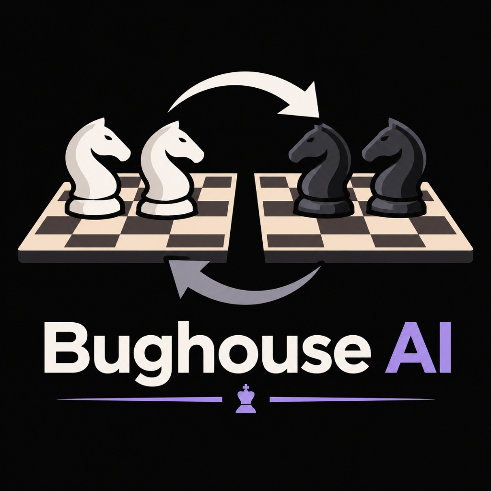

  

# Bughouse AI: Multi-Agent Monte Carlo Tree Search

An autonomous, tournament-grade artificial intelligence engine for **Bughouse Chess** powered by Monte Carlo Tree Search (MCTS) with Polynomial Upper Confidence Trees (PUCT), zero-sum adversarial minimax turn inversion, stochastic partner modeling, and real-time decision-tree visualization.

---

## Overview

**Bughouse** is a dynamic, high-speed chess variant played across two simultaneous boards by two cooperating teams of two players:
* **Team 1:** Board A White + Board B Black
* **Team 2:** Board A Black + Board B White

### Core Mechanics
1. **Piece Recycling:** Captured pieces are not eliminated from play. They immediately transfer to the partner's **piece reserve bank**.
2. **The Drop Action:** On any turn, instead of moving an existing piece on the board, a player holding reserve pieces may **DROP** any piece onto any vacant square (pawns cannot land on rank 1 or rank 8).
3. **Sudden-Death Win Condition:** The first checkmate on **either** board immediately wins the match for that team. Boards cannot be evaluated in isolation—a sacrifice on Board A can feed the decisive mating drop on Board B.

---

## The Search Challenge: Why Minimax Fails

In standard chess, the average branching factor is $b \approx 35$. In Bughouse, a typical mid-game position contains 30 to 45 vacant squares. Holding just two reserve pieces adds $2 \times 35 = 70$ legal drop actions on top of normal piece moves.

| Search Metric | Standard Chess | Bughouse Chess |
|:---|:---:|:---:|
| **Board Setup** | 1 Board, Static pieces | 2 Simultaneous Boards, Recycled pieces |
| **Legal Action Types** | Moves only | Moves + **Piece Drops** |
| **Average Branching Factor ($b$)** | $b \approx 35$ | **$b \approx 80\text{ to }160+$** |
| **Search Tree at Depth 2** | $\approx 1.2 \times 10^3$ nodes | $\approx 2.5 \times 10^4$ nodes |
| **Search Tree at Depth 4** | $\approx 1.5 \times 10^6$ nodes | **$\approx 6.5 \times 10^8$ nodes ($>400\times$ explosion)** |
| **Minimax $\mathcal{O}(b^d)$ Tractability** | Alpha-Beta runs efficiently | **Combinatorial explosion (freezes/hangs)** |

Because exhaustive depth-first search is computationally intractable under $b \ge 100$, **Monte Carlo Tree Search (MCTS)** is strictly required. MCTS expands the search tree asymmetrically, concentrating simulation compute on tactically viable continuations while ignoring 90%+ of irrelevant drop permutations.

---

## Solver Architecture

### 1. Adversarial PUCT Selection
Tree traversal is guided by the Polynomial Upper Confidence Trees (PUCT) formula:

$$\text{Score}(s, a) = Q(s, a) + c_{\text{puct}} \cdot P(s, a) \cdot \frac{\sqrt{N(s)}}{1 + n(s, a)}$$

* **Exploitation $Q(s, a)$:** Empirical win rate accumulated across simulated rollouts.
* **Exploration $U(s, a)$:** Prior bonus scaled by domain tactical plausibility $P(s, a)$, decaying as visit count $n$ rises ($c_{\text{puct}} = \sqrt{2}$).
* **Zero-Sum Minimax Turn Inversion ($1 - Q$):** Naive MCTS assumes all nodes maximize the root player's reward (the "cooperative opponent" flaw). This engine inverts rewards on opponent plies ($1 - Q$), forcing the search tree to account for ruthless enemy refutations.

### 2. Tactical Move Priors $P(s, a)$ & Blunder Suppression
Uniform priors ($1/b$) waste simulation budgets on nonsensical flank drops. The engine computes domain-specific tactical priors:
* **Central Development:** Classical opening pushes (`e4`, `d4`, `Nf3`, `Nc3`) receive a $+4.5$ prior bonus.
* **Flank Suppression:** Passive edge moves (`h3`, `a3`, `Nh3`) are suppressed by 95% ($0.05\times$ multiplier).
* **MVV-LVA Captures:** Most Valuable Victim - Least Valuable Attacker prioritization.
* **Suicide Check Filter:** Naive engines frequently drop Queens/Knights onto attacked undefended squares just to deliver check. Using `chess.isAttacked()`, hanging drop checks are slashed to near-zero ($P = 0.005$), while safe, unanswerable checks are boosted ($+8.0$) and drop checkmates are maximized ($+120.0$).

### 3. Explicit Partner Uncertainty Modeling
Because the partner's board is an external asynchronous stochastic process, rollouts incorporate a **Stochastic Markov Arrival Process**:
* **Piece Arrival Rate:** $P(\text{capture at step } t) = \lambda \cdot \sigma_{\text{tactical}}$, with baseline $\lambda = 0.18$ and check surge multiplier $\sigma = 1.8$.
* **Empirical Capture Distribution:** Pawns 40%, Knights 22%, Bishops 18%, Rooks 14%, Queens 6%.
* Evaluates lines under realistic probability distributions of future incoming drop resources.

### 4. State Evaluation & King Drop Safety
Leaf states are evaluated via a 6-dimensional embedding vector $\vec{\phi}(s)$:
* **PeSTO Piece-Square Tables (PST):** Positional centipawn grid evaluation for center control and development.
* **Knight Valuation ($350\text{ cp}$ vs. Bishop $330\text{ cp}$):** Elevated because dropped knights jump over defensive pawn shields to deliver unblockable checks.
* **Reserve Bank Premium ($1.25\times$):** Off-board pieces are 25% more valuable than static on-board pieces due to drop versatility.
* **King Drop Hole Penalty:** $-35\text{ cp}$ penalty per vacant square adjacent to the friendly King to preemptively seal flight paths before enemy drop nets arrive.

---

## Empirical Benchmark Findings

Controlled head-to-head tournament matches were conducted directly inside the engine under fixed 200ms compute budgets:

| Experiment | Configuration Comparison | Win Rate (A vs. B) | Key Scientific Insight |
|:---|:---|:---:|:---|
| **1. Rollout Policy** | Heuristic-Guided vs. Pure Random | **33% vs. 50%** | Under tight time budgets, raw simulation throughput beat domain heuristic overhead (random completed $3\times$ more rollouts). |
| **2. Exploration Tuning** | Balanced ($C = 1.41$) vs. Greedy ($C = 0.5$) | **33% vs. 50%** | In sudden-death Bughouse, rapid 1-to-2 ply blunder refutations outperformed slow positional exploration. |
| **3. Partner Uncertainty** | Stochastic Markov vs. Static Baseline | **17% vs. 67%** | Revealed the **optimistic over-anticipation trap**: stochastic rollouts made speculative sacrifices expecting pieces that never arrived on Board B. The conservative static model showed superior tactical discipline. |

---

The project is live at **[bughouse.sumitk.me](https://bughouse.sumitk.me)**.
